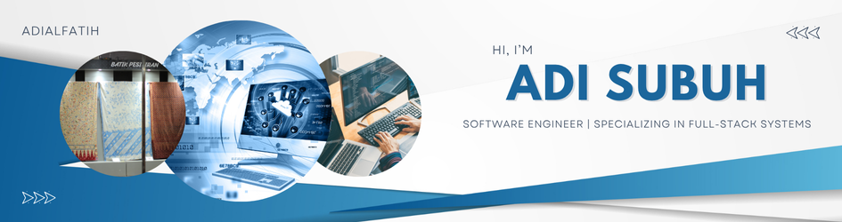

# Adi Subuh

### Software Engineer · Manufacturing & Operations Systems

**One engineer. Five factories. Fifteen systems in production.**

---

## About

Since 2020 I have been the entire software function of an Indonesian textile and printing group: **five plants, roughly 2,650 employees, 900+ daily users**. I gather the requirements on the factory floor, design the schema, write the code, run the rollout, and train the operators myself.

Nothing here was inherited from a previous team or a vendor. Every system was scoped, built, deployed, and taught by one person while the plants kept running three shifts a day.

| 5 | 15 | ~2,650 | 900+ | 126 | 24/7 |
|:-:|:-:|:-:|:-:|:-:|:-:|
| Plants | Systems in production | Employees covered | Daily named users | Machines monitored | Three-shift operation |

---

## Selected work

Full case studies, with the constraint, the decisions, and the trade-offs, are on **[adisubuh.my.id](https://adisubuh.my.id/)**. Screens are published with each client's permission and use dummy data.

### 🖨️ Fabric & Sarong Printing Production System · 2026
**Bimatex** · Laravel 13 · MySQL · REST API · WhatsApp Gateway · [Live demo ↗](https://adisubuh.my.id/demo/textile-printing-production/)

Tracks grey fabric from two weaving plants through outside finishing, eight machine stages per colour, QC, and cost of goods per order.
- **Constraint:** most of the fabric is never in the plant: it sits at a weaving plant, on the road, or at the finisher, and returns in partial shipments.
- **Result:** fabric everywhere in the chain shows up in one valued balance; operators log machine in/out from WhatsApp; 300+ automated tests; rolled out in stages over six weeks.

### 🧶 Spinning Mill Production Monitoring · 2026
**PT. Rindang Jati Spinning** · Laravel · Livewire · MySQL · PWA · [Live demo ↗](https://adisubuh.my.id/demo/spinning-mill-monitoring/)

119 machines, ~600 operators and supervisors, three shifts a day.
- **Constraint:** most users had never used a work application, devices are limited, and the network is unstable. Any friction and recording goes back to paper.
- **Result:** output per machine is visible the same day instead of after the period closes; shift comparisons run on one shared set of figures.

### 📊 Cross-Plant Executive Dashboard · 2026
**Rindang Group** · Laravel · REST API · Flutter · PWA · [Live demo ↗](https://adisubuh.my.id/demo/group-executive-dashboard/)

A consolidation layer that merges three separately built plant systems into one view for 15 directors and managers.
- **Constraint:** all three source systems run 24/7, so no database migration and no common schema; the integration could not touch any production write path.
- **Result:** production, sales, and receivables for three plants on one screen, shipped with zero downtime.

### 🧵 Woven Sarong Production Traceability · 2025
**PT. Putra Sahabat Textile** · Laravel · Livewire · MySQL · PWA · [Live demo ↗](https://adisubuh.my.id/demo/sarong-production-traceability/)

End-to-end traceability across 10 production stages and 4 warehouses, from raw material to receivables and broker commission.
- **Result:** stock traceable by brand, type, and colour in every warehouse; production can finally be compared against sales; grade split captured at inspecting and traced back to its process.

### 🎨 Batik Production Monitoring System · 2026
**Batik Nadhira · Batik Bosami · Batik Batboy · Nataya Fashion** · Laravel · MySQL · Tailwind · [Live demo ↗](https://adisubuh.my.id/demo/batik-production-monitoring/)

One codebase running four competing batik businesses, each deployed on its own infrastructure and differing only in brand identity.
- **Result:** cost of goods calculated from records at each production stage instead of estimates. All four clients agreed to be named.

### Also in production

| Year | System | For | Stack |
|:-:|---|---|---|
| 2026 | Delivery Notes & Shipping Queue | Rindang Jati Weaving, Salam Mandiri Textile, Putra Sahabat Textile | CodeIgniter · MySQL · Ajax |
| 2026 | HavaBot: WhatsApp assistant for cafés & restaurants | Grafamedia (internal product) | Node.js · Express · MySQL · WhatsApp Web.js |
| 2025 | Multi-Plant HRIS & biometric attendance (~2,500 employees, fingerprint + face recognition) | Rindang Jati Spinning, Salam Mandiri Textile, Bantaran Mulia Textile | Laravel · Node.js · MySQL · Hikvision ISAPI |
| 2025 | Sparepart & machine consumption control (stock variance cut from millions of rupiah to rounding error) | PT. Rindang Jati Spinning | Laravel 11 · Livewire · Node.js · QR / thermal printing |
| 2025 | Weaving Operations ERP (production → invoicing → receivables, reports pushed over WhatsApp) | Rindang Jati Weaving, Putra Sahabat Textile, Salam Mandiri Textile | Laravel · Livewire · Node.js · WhatsApp Web.js · PWA |

**Running in production at:** PT. Putra Sahabat Textile · PT. Rindang Jati Spinning · CV. Salam Mandiri Textile · CV. Bantaran Mulia Textile · Mega Jaya · Batik Nadhira · [Batik Bosami](https://batikbosami.com) · [Batik Batboy](https://batboy.id) · [SiRumah.id](https://sirumah.id)

---

## How I ship

I hand over a running operation, not a repository. What breaks an internal system is rarely the code; it is asking hundreds of people to change how they have worked for years.

1. **Requirements come from the floor, not from a document.** I watch the work at the machine before writing anything.
2. **The most urgent module ships first.** No big-bang launches. One painful problem goes live, proves itself over a real shift, then the system grows.
3. **Old records run in parallel until the reports match.** Manual records retire only after reports match three times in a row, about three months.
4. **Training at the workstation, repeated every shift.** The same material three times, at the machine that operator actually runs.
5. **I stay after go-live.** Every system here has been revised since launch because the operation changed, not because the code was wrong.

---

## Stack

**Integrations:** REST APIs between plant systems · WhatsApp gateways for alerts and reports · Hikvision ISAPI face recognition · fingerprint readers · thermal barcode / QR printers

---

## 📊 GitHub Activity

<picture>
  <source media="(prefers-color-scheme: dark)" srcset="https://raw.githubusercontent.com/adialfatih/adialfatih/output/pacman-contribution-graph-dark.svg">
  <source media="(prefers-color-scheme: light)" srcset="https://raw.githubusercontent.com/adialfatih/adialfatih/output/pacman-contribution-graph.svg">
  
</picture>

---

## Journey

| Period | Milestone |
|:-:|---|
| 2012–2015 | **First clients:** school websites and the first paid work, started while still in vocational school |
| 2016–2019 | **From pages to systems:** company profiles, then the first internal applications |
| 2020 | **Entering the factory floor:** the first production system for a textile plant |
| 2021–2023 | **One plant at a time:** production, warehousing, sales, AP/AR, HRIS, biometric attendance |
| 2024–2026 | **Consolidation & automation:** 15 systems, 5 plants, one executive dashboard |

---

## Work with me

A contract build, an ongoing retainer, or a full-time remote role. Tell me the problem you are trying to solve and I will tell you honestly whether I am the right person for it.

- **Engagement:** per-system contract, monthly retainer, or full-time remote
- **Time zone:** UTC+7 (Jakarta). A full working day of overlap with Europe, the UK, and Asia-Pacific; about three hours with the US East Coast
- **Contracting:** direct contract, contractor platform, or Employer of Record

📧 [adi@grafamedia.com](mailto:adi@grafamedia.com) · 🌐 [adisubuh.my.id](https://adisubuh.my.id/) · 💼 [LinkedIn](https://www.linkedin.com/in/adi-subuhadir-506419273)
